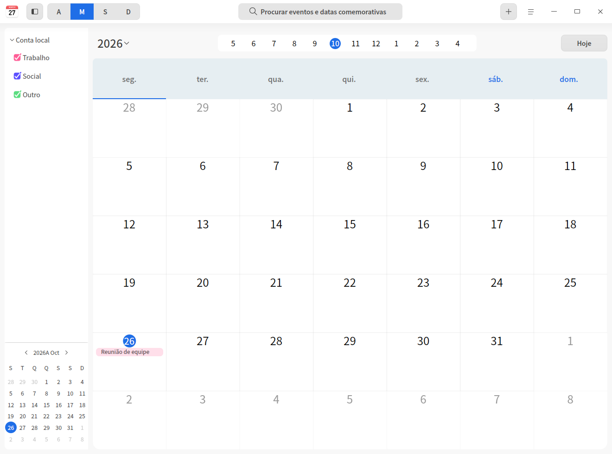
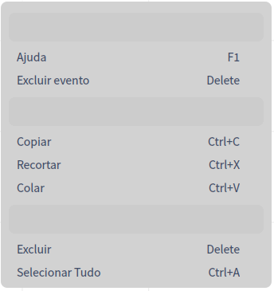
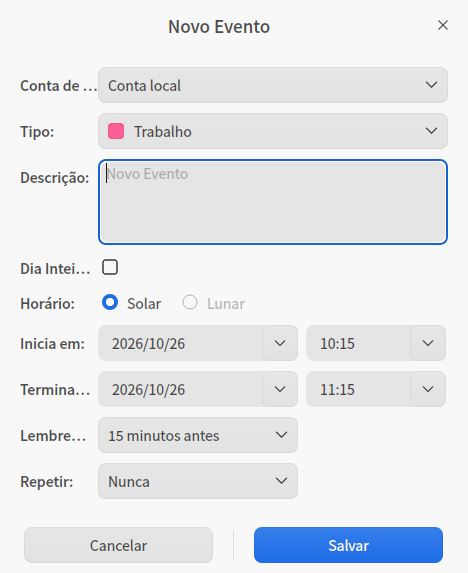
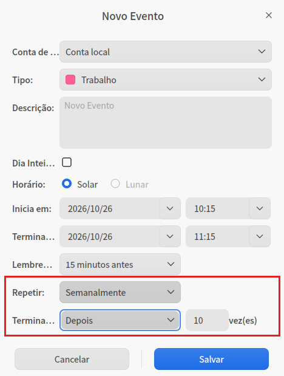

# Calendário|dde-calendar|

## Visão geral

O Calendário é uma pequena ferramenta para consultar datas e gerenciar eventos. Ele exibe o calendário lunar, o almanaque chinês (huangli), os termos solares e as datas festivas mais comuns, além de trazer lembretes de eventos que ajudam você a planejar melhor o seu tempo.

## Primeiros passos

Você pode iniciar o Calendário, fechá-lo ou criar um atalho das seguintes formas.

### Iniciar o Calendário

1. Clique no ícone do iniciador na barra de tarefas  para abrir a interface do iniciador.
2. Role a roda do mouse para cima ou para baixo ou use a busca para localizar o ícone do Calendário  e clique nele para iniciar.
3. Clique com o botão direito em  para:

   - Clicar em **Enviar para a área de trabalho** e criar um atalho na área de trabalho.
   - Clicar em **Enviar para a barra de tarefas** e fixar o aplicativo na barra de tarefas.
   - Clicar em **Iniciar automaticamente ao ligar** e adicionar o aplicativo aos itens de inicialização, para que ele seja executado automaticamente ao ligar o computador.

### Fechar o Calendário

- Na interface do Calendário, clique em  para sair do Calendário.
- Na barra de tarefas, clique com o botão direito em  e selecione **Fechar tudo** para sair do Calendário.
- Na interface do Calendário, clique em  e selecione **Sair** para sair do Calendário.

### Consultar os atalhos

Na interface do Calendário, use o atalho **Ctrl + Shift + ?** para abrir a interface de visualização dos atalhos. Usar os atalhos com fluência aumenta bastante a sua produtividade.

## Operações

O Calendário oferece as visões de ano, mês, semana e dia; cada visão apresenta as propriedades da data de uma maneira diferente.

O sistema exibe a visão de mês por padrão, e você pode alternar entre as visões de ano, mês, semana e dia com cliques do mouse.

- Apenas em sistemas em chinês o Calendário exibe a data correspondente no calendário lunar, o almanaque chinês e as informações de feriados.
- A data tem como ponto de partida o ano de **1900**; não é possível consultar datas anteriores a **1900** ao alternar entre as datas.
- Nas visões de mês e de semana, as datas de sábado e domingo são exibidas de forma diferente das de segunda a sexta-feira.

A barra lateral da visão do calendário exibe as contas de calendário e uma miniatura do calendário.

1. Clique em  para mostrar ou ocultar a barra lateral da janela.
2. Nas contas de calendário, marque o tipo de calendário desejado para que os eventos desse tipo apareçam na visão do calendário; se a marcação for removida, eles ficam ocultos na visão.
3. Na miniatura do calendário, na parte inferior da barra lateral, selecione uma data para alterar de forma sincronizada a data exibida na visão grande do calendário à direita.

<table border="1">
<tr>
   <th width="80px">Visão</th>
   <th width=“200px”>Descrição</th>
</tr>
<tr>
   <td>Ano</td>
   <td>Exibe os meses e os dias de todo o ano.</td>
</tr>
<tr>
   <td>Mês</td>
    <td>Exibe as informações de feriados e os eventos programados.</td>
</tr>
<tr>
   <td>Semana</td>
   <td>Exibe os eventos de cada dia da semana.</td>
</tr>
<tr>
   <td>Dia</td>
    <td>Exibe as informações de feriados, os eventos detalhados e o almanaque chinês.</td>
</tr> 
</table>

### Criar um evento

1. Crie um evento de uma das seguintes formas.
   - Na interface do Calendário, clique no botão de adicionar da barra de menus .
   - Nas visões de mês, semana ou dia, clique duas vezes em uma área vazia da data ou clique com o botão direito e selecione **Novo evento**.
   - Nas visões de mês, semana ou dia, clique e arraste o mouse para criar um evento.
   
2. A janela "Novo evento" é exibida. Selecione a conta de calendário e defina o tipo de evento, o conteúdo, o horário, o lembrete e outras informações.

<table border="1">
<tr>
   <th width="50px">Parâmetro</th>
   <th width="200px">Descrição</th>
</tr>
<tr>
   <td>Conta de calendário</td>
   <td>Por padrão, a conta local; é possível escolher contas de rede, como a UOS ID.</td>
</tr>
<tr>
   <td>Tipo</td>
   <td>O sistema oferece por padrão os tipos de evento "Trabalho", "Pessoal" e "Outros"; você também pode criar tipos de evento personalizados.
       <ol><li>Na lista suspensa de tipos, selecione <b>Novo tipo de evento</b>.</li>
          <li>O campo de tipo fica editável; digite o nome do tipo e defina a cor.</li></ol>
       Você também pode adicionar, editar ou excluir tipos de evento pela função de gerenciamento no menu principal; para os passos detalhados, consulte a seção "Gerenciar".</td>
</tr>
<tr>
   <td>Conteúdo</td>
   <td>Informações descritivas do evento.</td>
</tr>
<tr>
   <td>Horário do evento</td>
   <td>Define a data e o horário de eventos de dia inteiro ou com hora, do calendário gregoriano ou lunar.
   <ul>
        <li>Dia inteiro
         <ul><li>Com a opção Dia inteiro marcada, o horário de início e o de término aceitam apenas datas.</li>
            <li> Com a opção Dia inteiro desmarcada, o horário de início e o de término aceitam datas, horas e minutos. </li></ul>
         </li>
    </ul>
   <ul>
     <li>Horário
        <ul><li>Calendário gregoriano: o horário de início e o de término mostram apenas datas gregorianas.</li>
            <li>Calendário lunar: o horário de início e o de término mostram datas gregorianas e lunares.</li></ul>
     </li>
    </ul></td>
</tr>
<tr>
   <td>Lembrete</td>
   <td>
Com a opção Dia inteiro marcada, as opções de lembrete são: Nunca, No dia do evento (9h), 1 dia antes, 2 dias antes e 1 semana antes. 
Com a opção Dia inteiro desmarcada, as opções de lembrete são: Nunca, No início do evento, 15 minutos antes, 30 minutos antes, 1 hora antes, 1 dia antes, 2 dias antes e 1 semana antes.</td>
</tr>
<tr>
   <td>Repetir</td>
   <td>
Para eventos do calendário gregoriano, as opções de repetição são: Nunca, Todos os dias, Dias úteis, Todas as semanas, Todos os meses e Todos os anos. 
Para eventos do calendário lunar, as opções de repetição são: Nunca, Todos os meses e Todos os anos.</td>
</tr>
<tr>
   <td>Encerrar repetição</td>
   <td>A opção <b>Encerrar repetição</b> só aparece quando a repetição está configurada. As opções são: Nunca, Após n vezes e Em uma data.</td>
</tr> 
</table>

3. Clique em **Salvar** para criar o evento. Depois de criado, o evento aparece na visão do calendário como uma etiqueta.

### Editar um evento

1. Nas visões de mês, semana ou dia, clique duas vezes ou clique com o botão direito na etiqueta do evento.
2. Selecione **Editar**.
3. A janela "Editar evento" é exibida; ajuste as propriedades do evento e clique em **Salvar**. 
4. Se o evento for de dia inteiro ou tiver repetição, uma caixa de diálogo é exibida; confirme as informações para concluir a edição.

>  Observação: em eventos já criados, é possível alterar o horário de início e o de término arrastando a etiqueta do evento.

Ao editar um evento, o sistema exibe mensagens diferentes conforme o que foi alterado. Os botões dessas mensagens estão descritos na tabela abaixo.

<table border="1">
<tr>
   <th width="130px">Botão</th>
   <th width=“200px”>Descrição</th>
</tr>
<tr>
   <td>Todos os eventos</td>
   <td>Altera todos os eventos repetidos relacionados a este. </td>
</tr>
<tr>
   <td>Apenas este evento</td>
   <td>Altera apenas o evento atual.  </td>
</tr>
<tr>
   <td>Todos os eventos futuros</td>
   <td>Altera os eventos da data selecionada em diante; os eventos anteriores à data selecionada são mantidos.</td>
</tr>
<tr>
   <td>Todas as alterações  </td>
   <td>Altera todos os eventos repetidos.</td>
</tr> 
</table>

### Definir eventos de dia inteiro ou de vários dias

Ao criar ou editar um evento, defina o **Horário de início** e o **Horário de término** para configurar eventos de dia inteiro ou com duração de vários dias.

### Definir um evento recorrente

1. Ao criar ou editar um evento, na lista suspensa **Repetir**, escolha o ciclo de repetição do lembrete, por exemplo, Todos os meses.
2. Na lista suspensa **Encerrar repetição**, defina o número de repetições ou a data de encerramento.

### Pesquisar eventos

1. No campo de busca na parte superior da interface do Calendário, clique em  e digite a palavra-chave.
2. Pressione a tecla **Enter** do teclado para pesquisar.
3. No campo de busca, clique em  ou apague o texto digitado para limpar a palavra-chave atual ou cancelar a pesquisa.

### Consultar um evento

Nas visões de mês, semana ou dia, clique duas vezes na etiqueta do evento para abrir a janela "Meus eventos", onde é possível consultar o evento, [editar o evento](#editar-um-evento) ou [excluir o evento](#excluir-um-evento).

### Consultar os detalhes do lembrete de evento

Quando o sistema envia uma notificação, clique na caixa de notificação para ver os detalhes do evento.

Nos lembretes de evento, os botões das mensagens estão descritos na tabela abaixo.

<table border="1">
<tr>
   <th width="130px">Botão</th>
   <th width=“200px”>Descrição</th>
</tr>
<tr>
   <td>Lembrar depois</td>
   <td>Quando o lembrete está definido para o mesmo dia, após o primeiro aviso, clique em <b>Lembrar depois</b> para ser avisado novamente em 10 minutos; a cada novo clique em "Lembrar depois", o intervalo aumenta em 5 minutos. Você também pode escolher, na lista suspensa de "Lembrar depois", Em 15 minutos, Em 1 hora, Em 4 horas ou Amanhã. </td>
</tr>
<tr>
   <td>Lembrar amanhã</td>
   <td>Este botão aparece quando o lembrete está definido para 1 dia antes ou 2 dias antes.   </td>
</tr>
<tr>
   <td>Lembrar 1 dia antes </td>
   <td>Este botão aparece quando o lembrete está definido para 1 semana antes.</td>
</tr>
<tr>
   <td>Fechar</td>
   <td>Fecha a mensagem.</td>
</tr> 
</table>

### Excluir um evento

1. Nas visões de mês, semana ou dia, clique duas vezes ou clique com o botão direito na etiqueta do evento.
2. Selecione **Excluir**.
3. A caixa de diálogo "Você está excluindo um evento" é exibida; clique em **Excluir** para remover o evento.

Ao excluir eventos, os botões das mensagens para eventos repetidos e não repetidos estão descritos na tabela abaixo.

<table border="1">
<tr>
   <th width="130px">Botão</th>
   <th width=“200px”>Descrição</th>
</tr>
<tr>
   <td>Excluir evento</td>
   <td>Exclui um evento não repetido.  </td>
</tr>
<tr>
   <td>Excluir todos</td>
   <td>Exclui todos os eventos repetidos.</td>
</tr>
<tr>
   <td>Excluir apenas este evento </td>
   <td>Para eventos repetidos, exclui apenas o evento selecionado no momento.</td>
</tr>
<tr>
   <td>Excluir todos os eventos futuros</td>
   <td> Para eventos repetidos, exclui os eventos da data selecionada em diante; os eventos anteriores à data selecionada são mantidos.</td>
</tr> 
</table>

## Menu principal

No menu principal, você pode abrir as configurações de gerenciamento, consultar a política de privacidade, alternar o tema da janela, consultar o manual de ajuda e saber mais sobre o Calendário.

### Gerenciar

Clique em  > **Gerenciar** para abrir a interface de gerenciamento do calendário, onde é possível gerenciar os tipos de evento das contas de calendário, entrar com a UOS ID para sincronizar os dados dos eventos e as configurações do calendário na nuvem e ajustar as configurações gerais.

#### Sincronização do calendário na nuvem

O Calendário permite sincronizar os dados dos eventos e as configurações na nuvem por meio da UOS ID.

>  Observação: esta função ainda não está disponível para versões antigas do sistema UOS.

**Entrar e sair da UOS ID**

1. Na interface de configuração de contas, clique no botão **Entrar**.
2. A janela de login da UOS ID é exibida; conclua o login por nome de usuário e senha, código de verificação por celular ou leitura do QR code com o WeChat.
3. Após o login, são exibidos o nome da conta, o avatar e as configurações de sincronização relacionadas; clique em **Sair da conta** para desconectar a conta UOS ID.

**Configurações de sincronização do calendário**

1. Com a UOS ID conectada, marque as caixas de seleção ao lado de **Eventos** e **Configurações gerais** para definir o que será sincronizado na nuvem.

2. Clique na lista suspensa de **Frequência de sincronização** para escolher a frequência da sincronização automática; você também pode selecionar **Sincronização manual** para desativar a sincronização automática.

3. Clique no botão **Sincronizar agora** para sincronizar imediatamente com os dados da nuvem.

>  Observação: é preciso ativar a **Sincronização do UOS Cloud** no Centro de Controle para usar a sincronização na nuvem.

#### Gerenciar tipos de evento

**Adicionar um tipo de evento**

1. Na interface de gerenciamento do calendário, clique no botão de adicionar .
2. A janela "Novo tipo de evento" é exibida; digite o nome do tipo e defina a cor.
3. Clique em **Salvar**.

**Editar um tipo de evento**

1. Na interface de gerenciamento do calendário, selecione um tipo personalizado.
2. Clique no botão de editar .
3. A janela "Editar tipo de evento" é exibida; digite o nome do tipo e defina a cor.
4. Clique em **Salvar**.

**Excluir um tipo de evento**

1. Na interface de configuração de contas, selecione um tipo personalizado.
2. Clique no botão de excluir  para remover o tipo de evento.

#### Configurações gerais

**Primeiro dia da semana**

Clique na lista suspensa de **A semana começa em** e selecione **Domingo** ou **Segunda-feira** como o primeiro dia da semana.

**Formato de hora**

Clique na lista suspensa de **Hora** e selecione **Formato de 24 horas** ou **Formato de 12 horas**; o formato de hora no calendário passa a ser exibido conforme a opção selecionada.

### Tema

O tema da janela inclui tema claro, tema escuro e tema do sistema.

1. Na interface do Calendário, clique em .
2. Selecione **Tema** e escolha uma cor de tema.

### Ajuda

Consulte o manual de ajuda para conhecer melhor o Calendário e usá-lo com mais facilidade.

1. Na interface do Calendário, clique em .
2. Selecione **Ajuda**.
3. Consulte o manual de ajuda do Calendário.

### Sobre

1. Na interface do Calendário, clique em .
2. Selecione **Sobre**.
3. Consulte a versão e a descrição do Calendário.

### Sair

1. Na interface do Calendário, clique em .
2. Selecione **Sair**.
